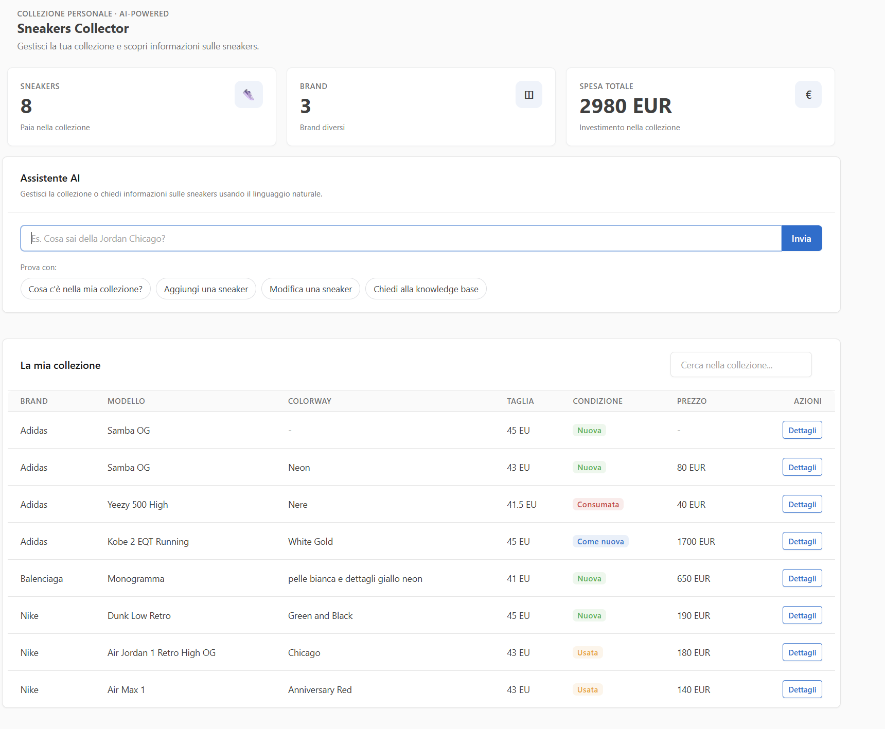
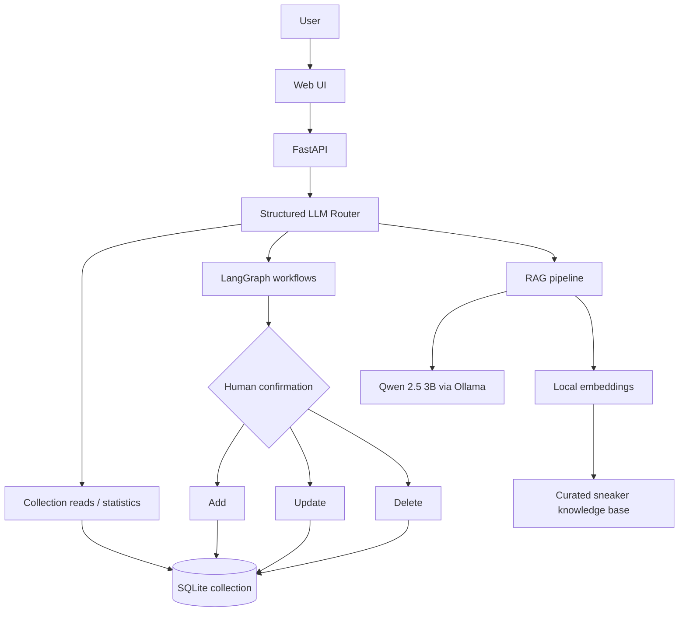
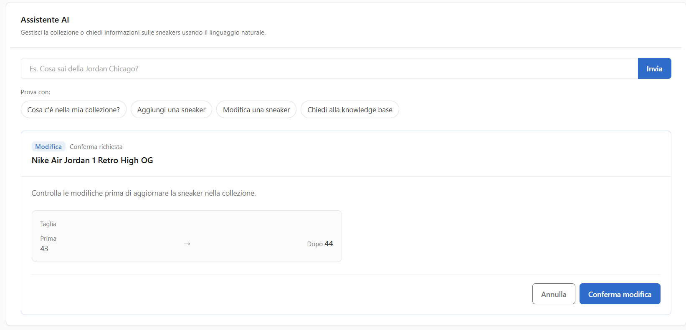
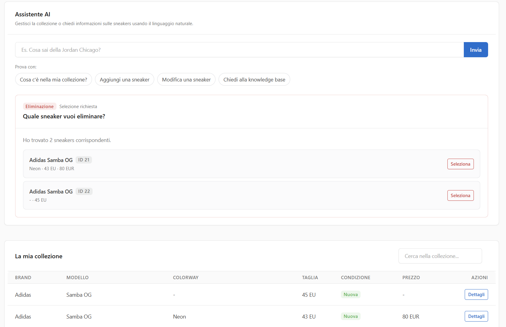
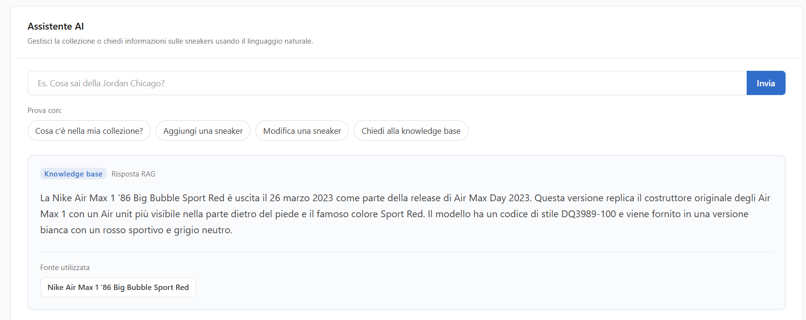

# Sneakers Collector AI

A local-first GenAI application for managing a personal sneaker collection through natural language.

The project combines **structured LLM routing**, **LangGraph human-in-the-loop workflows**, **SQLite persistence**, and **retrieval-augmented generation (RAG)** over a curated sneaker knowledge base. It is designed as a portfolio project focused on practical GenAI engineering rather than a generic chatbot demo.

## Application overview

The dashboard combines collection statistics, natural-language interaction and collection management in a single interface.



## Why this project

Sneaker collection management naturally mixes two different kinds of information:

- **Personal collection data** — what the user owns, sizes, condition, purchase price, notes, etc.
- **External sneaker knowledge** — release dates, style codes, model history and other reference information.

Sneakers Collector AI keeps these concerns deliberately separate:

```text
SQLite  -> source of truth for the user's collection
RAG     -> external sneaker knowledge
LLM     -> natural-language understanding and grounded generation
LangGraph -> orchestration and human approval for mutations
```

This separation makes the system easier to reason about, test and extend.

## Key features

- Natural-language management of a sneaker collection.
- Structured intent routing with Pydantic models.
- Collection listing, filtering, statistics and lookup by ID.
- Add, update and delete workflows orchestrated with LangGraph.
- Human confirmation before every collection mutation.
- Ambiguity handling for delete operations when multiple sneakers match.
- SQLite persistence for collection data and LangGraph checkpoints.
- Local RAG pipeline for sneaker knowledge.
- Local generation with **Qwen 2.5 3B** through Ollama.
- Local embeddings with **nomic-embed-text-v2-moe**.
- Deterministic normalization for explicit dates, conditions and box information.
- Separate evaluation suites for routing, extraction, retrieval and grounded generation.
- FastAPI backend with a lightweight server-rendered / vanilla JavaScript frontend.
- GitHub Actions CI for deterministic tests.

## Architecture



## How it works

### 1. Intent routing

The user's request is first converted into a structured decision such as:

- `list_collection`
- `search_collection`
- `collection_stats`
- `sneaker_by_id`
- `add_sneaker`
- `update_sneaker`
- `delete_sneaker`
- `sneaker_knowledge`
- `unsupported`

Pydantic models act as contracts between the LLM and the application, while deterministic Python code performs persistence and factual operations.

### 2. Human-in-the-loop collection mutations

Add, update and delete requests are not immediately committed to the database.

LangGraph first prepares a preview, interrupts the workflow and waits for explicit user approval. Only after confirmation is the SQLite mutation executed.

Collection changes are previewed before being persisted, allowing the user to review the requested modification.



For delete operations, if several collection entries match the same request, the UI presents the candidates and lets the user select the intended record before confirmation.



### 3. Retrieval-augmented generation

General sneaker questions are routed to the RAG pipeline rather than to the personal collection database.

The pipeline:

1. converts the query into an embedding, a numerical representation of its semantic meaning;
2. retrieves the most relevant document from the curated knowledge base;
3. rejects low-similarity retrievals using a minimum score threshold;
4. sends the retrieved context and the user's question to the local LLM;
5. returns the generated answer together with source metadata.

When no relevant document is found, the application returns a deterministic no-context response instead of asking the LLM to guess.

Example: asking **"Parlami delle Air Max Big Bubble"** retrieves the most relevant sneaker document and generates a grounded answer based on that source.



## Evaluation strategy

The project treats **deterministic software tests** and **LLM evaluations** as different concerns.

### Deterministic tests

These tests do not require a running local model and are suitable for CI. They cover areas such as:

- SQLite operations;
- API contracts;
- deterministic formatting;
- normalization;
- LangGraph workflows with mocked model behaviour.

Run them with:

```bash
python -m pytest -m "not eval" -v
```

### LLM and RAG evaluations

Tests marked with `eval` call the local Ollama models and evaluate model-dependent behaviour.

The curated evaluation datasets currently include:

| Area | Evaluation focus | Cases |
| --- | --- | ---: |
| Routing | Correct intent and structured arguments | 27 |
| Extraction | Structured sneaker field extraction | 12 |
| Retrieval | Top-1 document retrieval | 22 |
| RAG generation | Grounded factual answers / missing-data handling | 9 |
| Out-of-domain RAG | Deterministic no-context fallback | 1 |

Run model-dependent evaluations with:

```bash
python -m pytest -m eval -v
```

Retrieval and generation are evaluated separately on purpose: correct retrieval does not automatically imply a good generated answer, and generation quality should not hide retrieval failures.

## RAG knowledge base

The repository contains a manually curated knowledge base of **30 sneaker documents** covering models from Nike, Jordan, adidas, New Balance, ASICS, Salomon, PUMA, Reebok, Converse and Vans.

Each document can contain fields such as:

- brand;
- model;
- colorway;
- style code;
- release date;
- description;
- source metadata.

The dataset is intentionally small and controlled so that retrieval behaviour can be inspected and evaluated clearly. It is not intended to be a comprehensive sneaker database.

## Tech stack

| Area | Technology |
| --- | --- |
| Backend | Python, FastAPI |
| Validation | Pydantic |
| Agent orchestration | LangGraph |
| Persistence | SQLite |
| Checkpointing | LangGraph SQLite checkpointer |
| Local LLM | Ollama + Qwen 2.5 3B |
| Embeddings | Ollama + nomic-embed-text-v2-moe |
| RAG | Custom in-memory cosine-similarity retrieval |
| Frontend | Jinja2, Tabler, vanilla JavaScript |
| Testing | pytest |
| CI | GitHub Actions |

## Project structure

```text
sneakers-collector-ai/
├── app/
│   ├── main.py              # FastAPI endpoints
│   ├── agent.py             # Intent routing and collection responses
│   ├── graph.py             # LangGraph workflows and HITL orchestration
│   ├── llm.py               # Structured extraction through Ollama
│   ├── rag.py               # Embeddings, retrieval and grounded generation
│   ├── database.py          # SQLite persistence
│   ├── models.py            # Pydantic contracts
│   ├── normalization.py     # Deterministic text normalization
│   ├── tools.py             # Collection operations / formatting
│   ├── templates/
│   │   └── index.html
│   └── static/
│       ├── css/style.css
│       └── js/app.js
├── data/
├── evals/
│   ├── routing_cases.py
│   ├── extraction_cases.py
│   ├── retrieval_cases.py
│   ├── rag_generation_cases.py
│   └── run_*_eval.py
├── tests/
├── knowledge/
│   └── sneakers.json
├── screenshots/
│   ├── dashboard.png
│   ├── update-confirmation.png
│   ├── delete-ambiguity.png
│   └── rag-response.png
├── .github/workflows/tests.yaml
├── pytest.ini
└── requirements.txt
```

Runtime SQLite databases are stored under `data/` and are excluded from version control.

## Getting started

### Prerequisites

- Python 3.13 (the project is developed and tested on Python 3.13)
- Ollama installed and running locally

### 1. Clone the repository

```bash
git clone https://github.com/Aron-Davis/sneakers-collector-ai.git
cd sneakers-collector-ai
```

### 2. Create a virtual environment

**Windows PowerShell**

```powershell
python -m venv .venv
.\.venv\Scripts\Activate.ps1
```

**macOS / Linux**

```bash
python -m venv .venv
source .venv/bin/activate
```

### 3. Install dependencies

```bash
python -m pip install -r requirements.txt
```

### 4. Download the local models

```bash
ollama pull qwen2.5:3b
ollama pull nomic-embed-text-v2-moe
```

### 5. Run the application

```bash
python -m uvicorn app.main:app --reload
```

Open:

- Application: `http://127.0.0.1:8000/`
- FastAPI docs: `http://127.0.0.1:8000/docs`

## Example requests

The current application is Italian-first. Example requests include:

```text
Cosa c'è nella mia collezione?
```

```text
Aggiungi delle Adidas Samba OG taglia 43 EU, nuove, con scatola
```

```text
Cambia la taglia delle Jordan Chicago a 44 EU
```

```text
Elimina la sneaker con ID 14
```

```text
Qual è lo style code delle Yeezy Boost 350 V2 Zebra?
```

```text
Quando sono uscite le New Balance 574 Core grigie?
```

## Design decisions

### SQLite and RAG have different responsibilities

The RAG knowledge base is never used as the source of truth for the user's collection. Likewise, the collection database is not used to answer general sneaker-history questions.

This avoids mixing personal state with external reference information.

### LLMs interpret; Python decides

The LLM is used where natural-language understanding is valuable: routing, extraction and grounded response generation.

Deterministic concerns such as persistence, statistics, validation, explicit date parsing and database mutations remain in Python and SQLite.

### Mutations require approval

Potentially destructive or state-changing actions are always presented to the user before execution. LangGraph checkpoints preserve the interrupted workflow until it is explicitly resumed.

### Retrieval and generation are tested independently

Retrieval quality is measured using expected document IDs, while generation tests verify factual inclusion and basic hallucination resistance. This makes failures easier to diagnose.

## Limitations

- The knowledge base contains only 30 manually curated documents.
- Embeddings are stored in memory rather than in a persistent vector database.
- The local `qwen2.5:3b` model is intentionally lightweight; occasional linguistic imperfections may occur, especially in Italian phrasing.
- The application is currently Italian-first rather than fully internationalized.
- LLM-dependent evaluations require Ollama and are therefore not part of the default GitHub Actions workflow.
- The project is designed as a single-user portfolio application and does not currently include authentication or multi-user isolation.

## Possible future improvements

- Replace the in-memory embedding index with a persistent vector store.
- Expand the knowledge base using a clearly licensed external sneaker dataset.
- Add a provider/model abstraction for testing different LLMs and embedding models.
- Add full multilingual UI support.
- Extend evaluation datasets and introduce aggregate quality reporting.
- Run model-dependent evaluations in an environment with a managed Ollama/model service.


This project was built to explore the engineering patterns behind a small but complete local GenAI application: structured outputs, orchestration, human approval, retrieval, grounding, evaluation and deterministic application logic.
